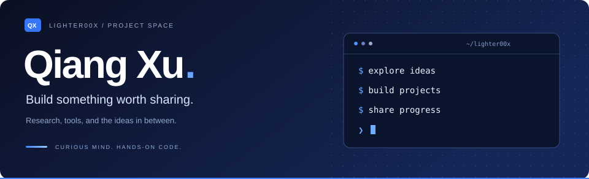
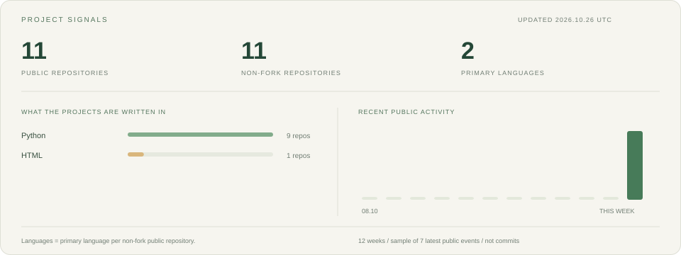

  

  <a href="https://lighter00x.github.io/">个人博客 · Blog</a> &nbsp; / &nbsp;
  <a href="https://scholar.google.com.hk/citations?user=31kG1i8AAAAJ&amp;hl=zh-CN">Google Scholar</a> &nbsp; / &nbsp;
  <a href="mailto:1002xu@stu2024.jnu.edu.cn">Email</a>

### A little about me

我是 **Qiang Xu**，目前在暨南大学学习，关注大语言模型与深度学习。喜欢把问题拆解成可以动手实现的小项目，也在这里记录探索的过程。

I'm studying at **Jinan University**, with interests in large language models and deep learning. I build projects to explore ideas and share what I learn along the way.

**Across my repositories:** model training · adversarial robustness · document intelligence · learning tools

---

### The project shelf

从研究实验到文档工具，记录具体问题如何落到代码里。

<table>
  <tr>
    <td width="50%" valign="top">
      01 / MODEL TRAINING
      <h3><a href="https://github.com/lighter00x/OPD-Rethinker">OPD-Rethinker ↗</a></h3>
      
围绕在线策略蒸馏与 GRPO 的训练实验工程，包含多机环境配置、训练启动、推理评测与指标同步脚本。

      
<code>Distillation</code> <code>GRPO</code> <code>Ray</code>

    </td>
    <td width="50%" valign="top">
      02 / ADVERSARIAL ROBUSTNESS
      <h3><a href="https://github.com/lighter00x/BitCons-AT">BitCons-AT ↗</a></h3>
      
探索图像位平面与对抗鲁棒训练，结合低位视图搜索和一致性约束，提供训练、消融实验及多种攻击评测流程。

      
<code>PyTorch</code> <code>Adversarial Training</code>

    </td>
  </tr>
  <tr>
    <td valign="top">
      03 / DOCUMENT INTELLIGENCE
      <h3><a href="https://github.com/lighter00x/PaperParser">PaperParser ↗</a></h3>
      
基于 LLM 的论文信息提取系统，串联文档解析、分子检测与识别，提取化合物和构效关系等信息，支持批量与持续处理。

      
<code>LLM</code> <code>YOLO</code> <code>Information Extraction</code>

    </td>
    <td valign="top">
      04 / DOCUMENT ENGINEERING
      <h3><a href="https://github.com/lighter00x/doc_operation">doc_operation ↗</a></h3>
      
基于 MinerU 与 VLM 的文档布局处理流水线，合并同页及跨页的表格、图片等元素，导出 Markdown 与 PDF。

      
<code>MinerU</code> <code>VLM</code> <code>Document Layout</code>

    </td>
  </tr>
  <tr>
    <td valign="top">
      05 / AGENT SYSTEMS
      <h3><a href="https://github.com/lighter00x/SearchAgent-Ascend">SearchAgent-Ascend ↗</a></h3>
      
将 SearchAgent-Zero 搜索 Agent 训练链路适配到昇腾 NPU，整合多轮工具调用、远端检索、训练配方与实验监控。

      
<code>Agents</code> <code>Ascend</code> <code>Reinforcement Learning</code>

    </td>
    <td valign="top">
      06 / LEARNING TOOLS
      <h3><a href="https://github.com/lighter00x/hot100">Hot100 Helper ↗</a></h3>
      
内置 100 道算法题解的查阅技能，支持按题名、编号与关键词匹配，输出解题思路、复杂度分析和 ACM 格式 Python 代码。

      
<code>Algorithms</code> <code>Python</code> <code>Skill</code>

    </td>
  </tr>
</table>

**More from the workbench**

- [legacy_mineru_merge](https://github.com/lighter00x/legacy_mineru_merge) — 独立的旧版 MinerU 解析与 VLM 布局合并流水线，提供批处理客户端和 HTTP 服务。
- [paper_extract](https://github.com/lighter00x/paper_extract) — 医药分子论文信息处理项目，将 PDF 初步解析与后续分子信息处理串联起来；模型权重及运行配置需按说明自行准备。

<a href="https://github.com/lighter00x?tab=repositories">浏览全部仓库 / Explore all repositories →</a>

### Signals from my repositories

语言按公开非 fork 仓库的主要语言统计；活动来自 GitHub 返回的最近公开事件样本，不等同于完整贡献或提交数。

### Outside the code

我也会把学习与项目实践写成文章。 / Notes from the things I build and learn.

<!-- BLOG:START -->
- [我的 verl 实践（一）：在昇腾 910B 上跑通第一次 GRPO 训练](https://lighter00x.github.io/posts/verl-01/)
- [我的 verl 实践（二）：让训练看得见——Ray、Prometheus 与 Grafana](https://lighter00x.github.io/posts/verl-02/)
- [我的 verl 实践（三）：把搜索 Agent 训练搬到昇腾](https://lighter00x.github.io/posts/verl-03/)
<!-- BLOG:END -->

---

Build with curiosity. Keep a record. Make the next thing better.

